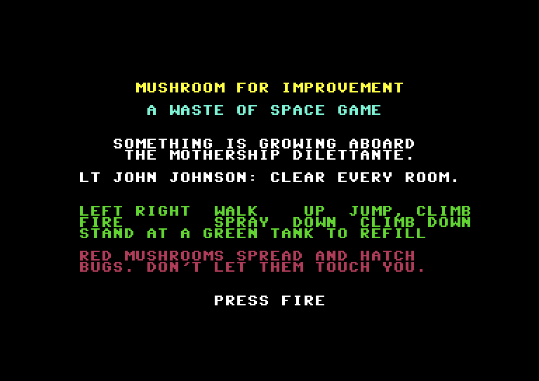
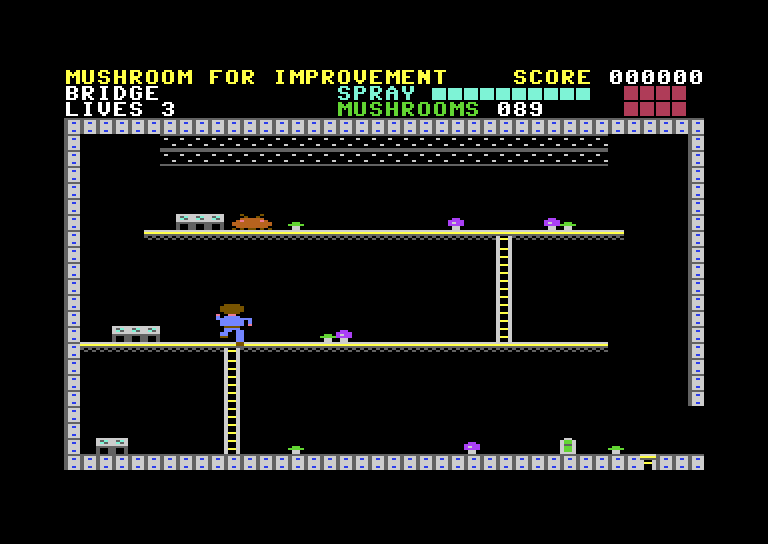
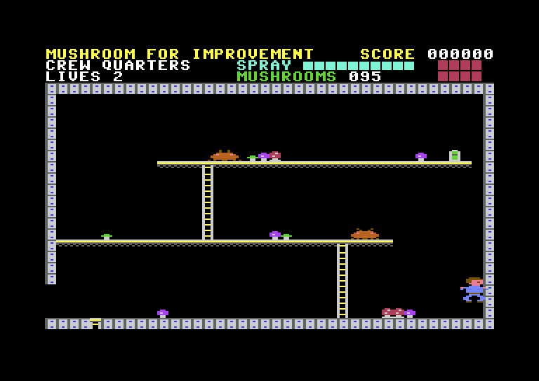

# Mushroom for Improvement

  

A Waste of Space game for the C64. 6502 assembly (KickAssembler), joystick in port 2.

Something is growing aboard the mothership Dilettante. Lt John Johnson clears it
room by room with a can of weedkiller spray. 8 flick-screen rooms (2 decks of 4),
doors at the sides, ladder shafts between the decks.

- Left/right walk, up = climb a ladder (or jump, with left/right for a long jump),
  down = climb down, fire = spray (stand still, you can turn).
- Mushrooms grow green -> purple -> red. Red ones pulse, spread to the next spot
  on the floor and now and then pop and hatch a bug. Spray knocks a mushroom down a stage.
- Bugs walk the platforms and chase you on your level. Touch = a life lost.
- Green tanks refill the can. Map top right: red = room still infested.
- Win: every room clear (no mushrooms, no bugs).

## Build
`build.bat` (build + run in VICE), `build.bat norun`. Uses the tools in `..\tools` (KickAssembler, VICE; see the main README).
Output: `build/mushroom.prg`, `build/mushroom.d64`.

Test builds: `-define SKIPTITLE`, `-define JOYTEST` (scripted joystick).

## Editing
- `src/rooms.asm`: the rooms as text (legend at the top). Neighbours: `room_left/right/up/down` in main.asm.
- `src/gfx.asm`: characters (4 x 8 fat pixels) and sprites (12 x 21), same text-art as the asteroids game.
- Growth speed: `GROW_LOOKS`, `GROW_MASK`, `POP_MASK`, `SEED_MASK` (explained there) at the top of `src/main.asm`.
- `src/music.asm`: title tune (E minor) + jingles, same player as the asteroids game.
