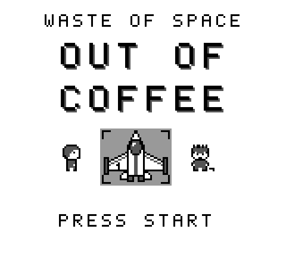
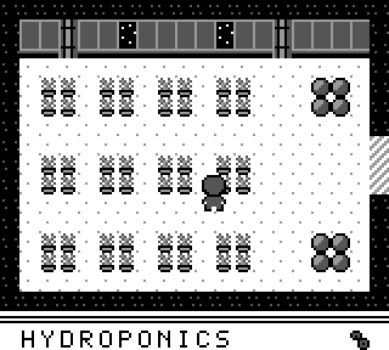
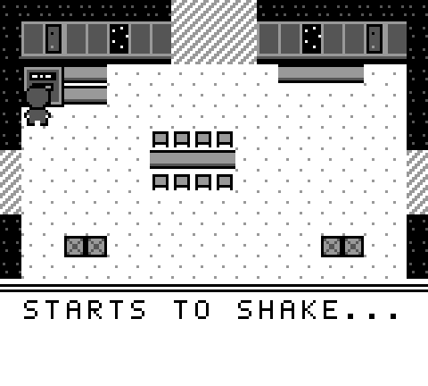

# Out of Coffee

  

A Waste of Space adventure for the original Game Boy (4 shades), in SM83 assembly.

- Double-click `run.bat` to build and play in SameBoy. `build.bat` only builds `build\coffee.gb`.
- Tools in `..\tools\` (not in git; see the main README): RGBDS 1.0.4 (`..\tools\rgbds`), SameBoy 1.0.5 (`..\tools\sameboy`).
- Art is text: `art\tiles.txt`, `art\sprites.txt`, `art\font.txt`, `art\items.txt`, `art\rooms.txt`, `art\things.txt` (who says what, with if/do story lines).
  `tools\gfx.py` turns it into `src\gen\*.asm` on every build (and checks doors line up).
- `python tools\playtest.py` plays the whole story start to finish headless and checks the story state at each step.
- `python tools\shot.py build\coffee.gb out 200 left:60 shot:name` plays it headless (PyBoy) and saves screenshots.

SameBoy keys: arrows, X = A, Z = B, Enter = Start, Backspace = Select.
